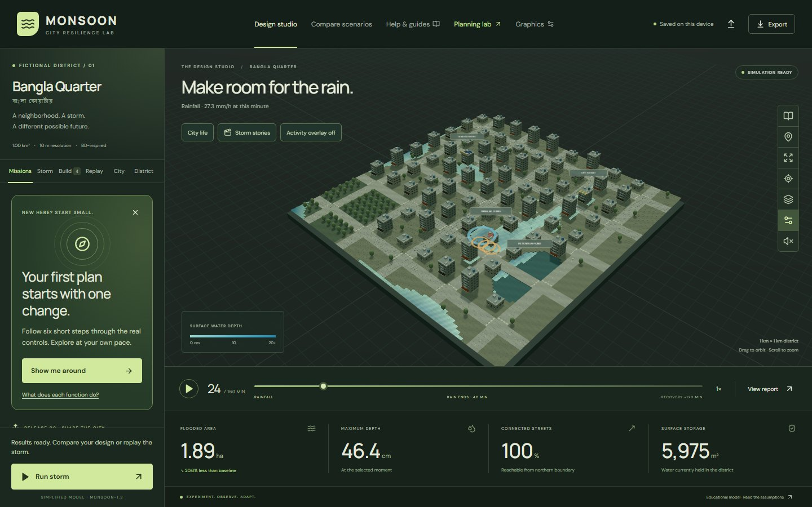

# MONSOON — City Resilience Lab

[](https://github.com/AtomicWorks/monsoon-city-lab/actions/workflows/ci.yml)

**Design a neighbourhood that can weather the storm.** MONSOON is an interactive 3D planning lab set in Bangla Quarter, a fictional Bangladesh-inspired district. Place rain gardens, retention basins, permeable paving and drain upgrades, run a monsoon storm, and watch minute by minute how your design changes flooding, street access and recovery compared with the untouched district.

**[Try the live demo →](https://monsoon-city-lab.vercel.app)** It runs entirely in the browser, with no sign-in.



## Try this first

Open **Replay → Demos → Protect the clinic** and choose **Load & simulate demo**. A 92-credit design of one basin and three drain upgrades runs against the same storm as the unchanged district. Scrub the timeline and open **Compare scenarios**, then go to the **City** tab and choose **Banglar Clinic** to see when its access disappears and returns.

## What you can do

- **Shape the storm:** three rainfall profiles, intensity, duration, blocked drains, a shared outlet limit and up to three hours of recovery.
- **Build within a budget:** place up to eight interventions for 100 credits, then move, copy or undo them.
- **Take on missions:** four challenges, from keeping the clinic reachable to keeping a whole set of services connected, each with a tested solution.
- **Compare outcomes:** linked side-by-side views, a reveal slider, a difference map and impact cards for flooded area, clinic access and school entrance depth.
- **Ask why:** select any spot to see its water depth, soil storage, drainage and the improvements covering it. Replay a storm as a sequence of measured events.
- **Reshape the district:** paint blocks as parks, roads or buildings, or start from four neighbourhood presets.
- **Plan seriously:** the Planning lab saves designs, compares up to three, searches for better portfolios, stress-tests a plan against harsher storms and prints a report.
- **Share:** scenario links and JSON export. Everything else stays on your device.

## How it works

The district is a 100 × 100 grid of 10 m cells. A storage-transfer model in a Web Worker moves water between cells by water-surface height, through soil and into drains with limited capacity, and accounts for every litre of rain. The same storm is run twice, once for the unchanged district and once for your design, so every result is a like-for-like comparison. three.js renders the recorded snapshots; it never affects the numbers.

This is an uncalibrated educational model, not a flood forecast or engineering tool. [docs/MODEL.md](docs/MODEL.md) covers the physics, units, thresholds and limits.

## Built with

React 19, TypeScript, Vite, three.js, Web Workers and IndexedDB. There is no backend: the app is static files.

- The simulation engine (`src/engine.ts`) is independent of React and rendering.
- The 3D scene and the Planning lab load on demand, so the panels appear before three.js has downloaded.
- Fonts are self-hosted; the app makes no third-party requests.

## Run it locally

Requires Node.js 22 or newer.

```sh
npm install
npm run dev
```

| Command             | What it does                                                                                     |
| ------------------- | ------------------------------------------------------------------------------------------------ |
| `npm run dev`       | Development server at http://127.0.0.1:5173                                                      |
| `npm test`          | Unit tests: water conservation, determinism, missions, storage, sharing and more                 |
| `npm run test:e2e`  | Playwright smoke test of the production build (run `npx playwright install chromium` once first) |
| `npm run typecheck` | Type-checks the app, tests and configs                                                           |
| `npm run build`     | Production build in `dist/`                                                                      |
| `npm run preview`   | Serves the production build                                                                      |

GitHub Actions runs the type checks, unit tests, build and smoke test on every pull request. [QA.md](QA.md) records the browser verification done for each release.

## Project structure

| Path                                     | Role                                                         |
| ---------------------------------------- | ------------------------------------------------------------ |
| `src/engine.ts`                          | Hydrology model, scenario validation and district layouts    |
| `src/worker.ts`                          | Runs the baseline and design simulations off the main thread |
| `src/City.tsx`                           | three.js scene that renders recorded water depths            |
| `src/main.tsx`                           | App shell: state, editing, simulation runs and playback      |
| `src/*Panel.tsx`, `src/Timeline.tsx`     | Studio panels, timeline and results; state comes from `main` |
| `src/planning.ts`, `src/PlanningLab.tsx` | Saved plans, comparison, search and stress tests             |
| `src/storage.ts`                         | IndexedDB autosave and plan library                          |
| `tests/`, `e2e/`                         | Unit tests and the browser smoke test                        |

## Deployment

Vercel builds `main` to [monsoon-city-lab.vercel.app](https://monsoon-city-lab.vercel.app) and creates a preview for each pull request. Any static host works: deploy the `dist/` folder from `npm run build`. No API keys or server are needed.

## History

[CHANGELOG.md](CHANGELOG.md) describes every release, from the first guided missions (Release 02) to the district editor (Release 08) and the maintenance release that followed (Release 09).

## License

Copyright © 2026 Asifur Rahman Bhuiyan. All rights reserved. The source is available to view; see [LICENSE](LICENSE).
